
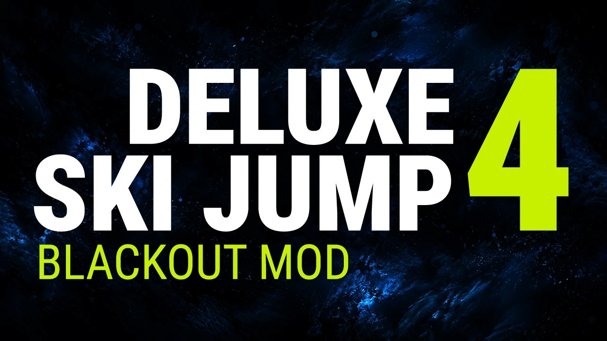

# DSJ4 BLACKOUT MOD

Nieoficjalny mod do **Deluxe Ski Jump 4** (wersja gry 1.12.3): telewizyjny HUD z własnym edytorem, nowe menu
z obsługą gry online, własny styl lotu skoczków, zasady wiatru i belki jak w Pucharze Świata, własna tablica
na belce i rekordy życiowe. Każdą część włączasz i wyłączasz osobno w launcherze.

Mod nie zawiera plików gry — potrzebna jest Twoja kopia DSJ4.

**[Pobierz najnowszą wersję](../../releases/latest)**

## Spis treści

- [Instalacja](#instalacja)
- [Launcher](#launcher)
- [HUD transmisji i edytor HUD](#hud-transmisji-i-edytor-hud)
- [Menu moda](#menu-moda)
- [Styl lotu](#styl-lotu)
- [Tablica na belce](#tablica-na-belce)
- [Wiatr i belka](#wiatr-i-belka)
- [Rekordy i następny zawodnik](#rekordy-i-następny-zawodnik)
- [Gra online](#gra-online)
- [Licencja](#licencja)

## Instalacja

1. Pobierz `DSJ4-BLACKOUT-MOD-<wersja>-setup.exe` z zakładki **[Releases](../../releases)** i uruchom.
2. Wskaż folder gry — ten, w którym jest `DSJ4.exe`.
3. Uruchom grę raz z modem. Mod przygotuje potrzebne pliki (np. model skoczka do edytora stylu lotu).
4. Ustawienia zmieniasz w programie **DSJ4 BLACKOUT MOD** (menu Start albo skrót na pulpicie).

**Ostrzeżenie Windows.** Pliki nie są podpisane cyfrowo, więc przy pierwszym uruchomieniu Windows SmartScreen
może pokazać „System Windows ochronił ten komputer”. Kliknij **Więcej informacji → Uruchom mimo to**.

**Uprawnienia.** Instalator ustawia grę i programy moda tak, żeby działały jako administrator, i nadaje prawo
zapisu do folderu `DSJ4Mod` — gra zwykle stoi w `Program Files`, a mod zapisuje tam ustawienia, log i pliki
wypakowane z gry.

**Aktualizacja.** Uruchom instalator nowszej wersji — ustawienia i Twoje projekty HUD zostają.

**Wersja ZIP.** Wypakuj całą zawartość do folderu gry. Jeśli gra jest w `Program Files`, nadaj użytkownikom
prawo „Modyfikacja” do folderu `DSJ4Mod` (Właściwości → Zabezpieczenia) — launcher ostrzeże, gdy go brakuje.

**Odinstalowanie.** Przez „Aplikacje” w Windows albo — przy wersji ZIP — usuń `dinput8.dll` i folder `DSJ4Mod`.

## Launcher

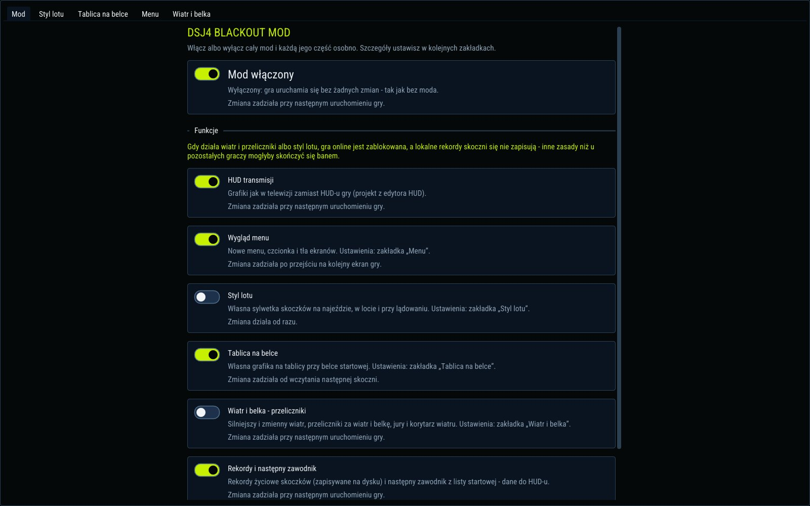

Zakładka **Mod** włącza i wyłącza cały mod i każdą jego część osobno:

| Przełącznik | Co robi | Kiedy działa zmiana |
|---|---|---|
| **Mod włączony** | Wyłączony: gra startuje bez żadnych zmian, tak jak bez moda. | po ponownym uruchomieniu gry |
| **HUD transmisji** | Grafiki jak w telewizji zamiast HUD-u gry (projekt z edytora HUD). | po ponownym uruchomieniu gry |
| **Wygląd menu** | Funkcja eksperymentalna, domyślnie wyłączona: nowe menu, czcionka i tła ekranów (zakładka *Menu*). | od następnego ekranu gry |
| **Styl lotu** | Własna sylwetka skoczków (zakładka *Styl lotu*). | od razu |
| **Tablica na belce** | Własna grafika na tablicy przy belce (zakładka *Tablica na belce*). | od następnej skoczni |
| **Wiatr i belka – przeliczniki** | Zmienny wiatr, przeliczniki, jury, korytarz (zakładka *Wiatr i belka*). | po ponownym uruchomieniu gry |
| **Rekordy i następny zawodnik** | Rekordy życiowe skoczków i następny zawodnik — dane dla HUD-u. | po ponownym uruchomieniu gry |

Stąd uruchomisz też grę, edytor HUD i otworzysz folder moda. W trakcie gry online przełączniki stylu lotu
oraz wiatru i belki są zablokowane (patrz [Gra online](#gra-online)).

## HUD transmisji i edytor HUD

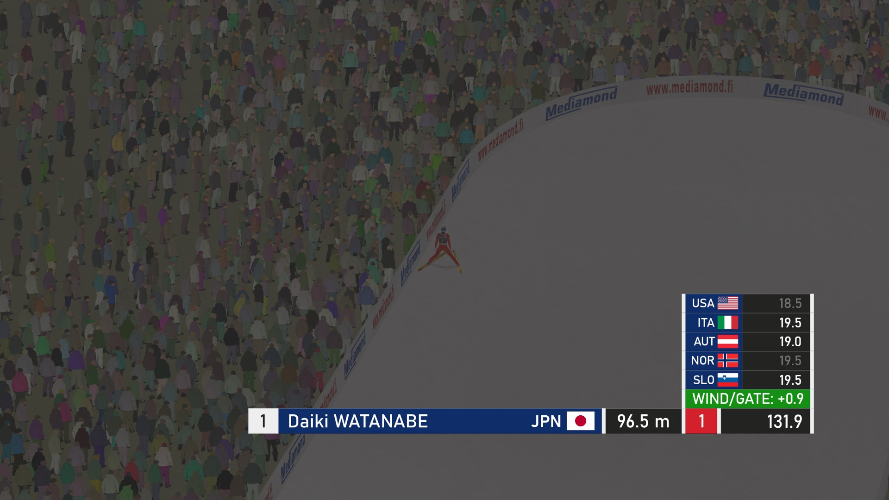

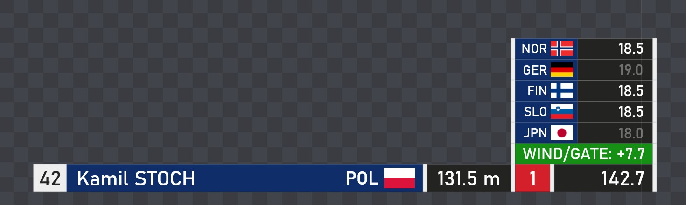

HUD transmisji zastępuje HUD gry grafikami w stylu telewizyjnym. Wygląd projektujesz w **edytorze HUD**
(`DSJ4HudEditor.exe`), a gra rysuje go dokładnie tak jak podgląd w edytorze. Zapis w edytorze trafia
do uruchomionej gry od razu — bez restartu.

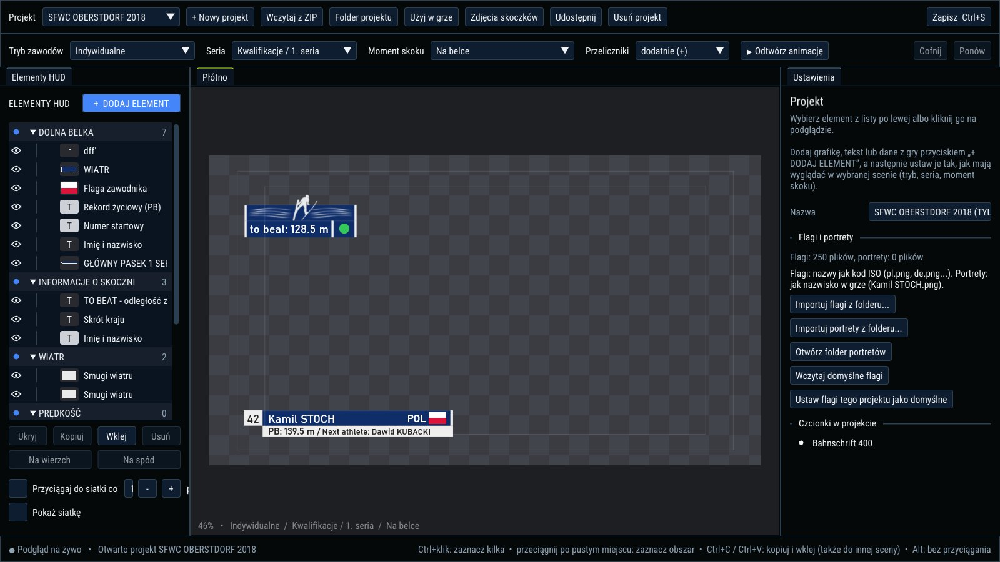

**Sceny.** Każdy element należy do sceny: tryb zawodów (indywidualne, drużynowe / Super Team, KO), seria
i moment skoku (na belce, w locie, po lądowaniu). W drużynówkach 1. seria ma osobną scenę dla 1. grupy, w której
drużyny nie mają jeszcze miejsca ani punktów. Elementy „we wszystkich scenach” (np. logo TV) widać zawsze.
Jeśli projekt nie ma żadnych elementów dla danego trybu i serii, w grze zostaje oryginalny HUD gry.

**Elementy** (przycisk *+ Dodaj element*):

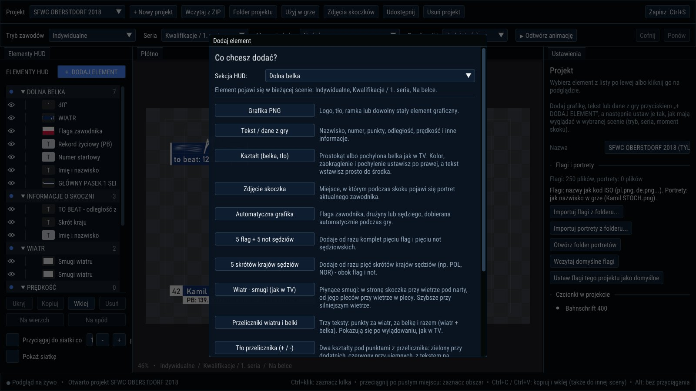

- teksty z danymi z gry: zawodnik, kraj, numer, odległość, punkty, miejsce, belka, prędkość, skocznia, wynik
  „to beat” (do prowadzenia, także na bieżąco z przelicznikami), rekordy, następny zawodnik i wiele innych;
- grafiki PNG, prostokąty i kształty z zaokrągleniami, gradientami i obrysem;
- flagi zawodnika, drużyny i sędziów, portrety skoczków (`HUD\<projekt>\portraits\Imię NAZWISKO.png`);
- światła startowe (jedno światło zmieniające kolor albo trzy osobne);
- wiatr: strzałka, strzałka 3D i płynące smugi z innym kolorem, gdy wiatr wychodzi poza korytarz (przy włączonym
  korytarzu wiatru);
- noty sędziów z krajami — odrzucona najwyższa i najniższa nota może być przekreślona albo przygaszona;
- nota skoczka (punkty tego skoku) i nota drużyny (suma drużyny w konkursie) — także w drużynówkach;
- **Next 5** — pięciu kolejnych zawodników z listy startowej, i **TOP5** — bieżąca klasyfikacja konkursu
  (zawodnicy albo drużyny z punktami), jako gotowe elementy w *+ Dodaj element*;
- elementy widoczne tylko przy dodatnim, ujemnym albo zerowym przeliczniku (wiatr 0.0 i belka bez zmiany) —
  projekt bez elementów „przy zerowym” pokazuje przy 0.0 te „przy dodatnim”.

**Animacje.** Wejście i wyjście elementów: przenikanie, wjazdy z każdej strony, skalowanie, odsłanianie,
z czasem, opóźnieniem i płynnością. *Znika po czasie* — element schodzi z ekranu po ustawionej liczbie sekund,
więc w tym samym miejscu można potem pokazać inny.

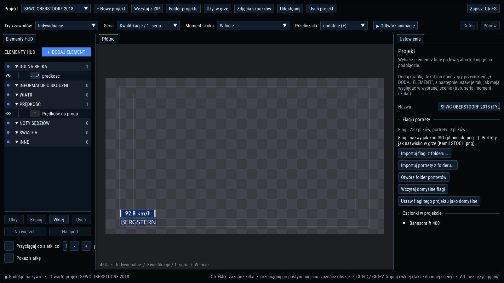

**Udostępnianie.** *Udostępnij* zapisuje cały projekt jako jeden plik ZIP (bez czcionek Windows i czcionek,
których licencja nie pozwala rozsyłać; zdjęcia skoczków opcjonalnie). *Wczytaj z ZIP* dodaje projekt innego
gracza jako nowy. *Użyj w grze* wybiera projekt, który rysuje gra.

## Menu moda

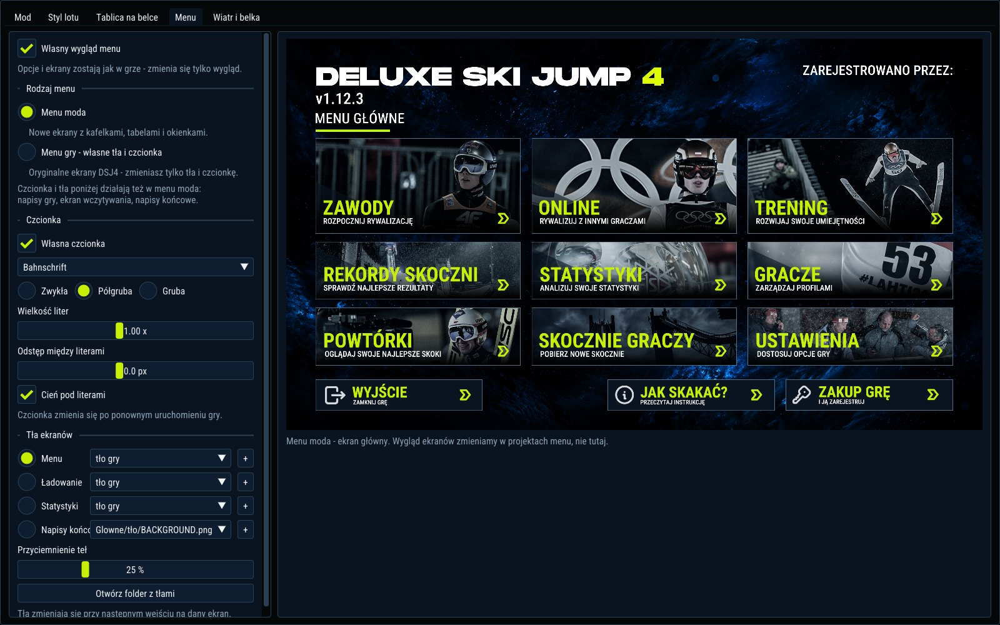

Własny wygląd menu to **funkcja eksperymentalna** — domyślnie wyłączona (w launcherze oznaczona innym kolorem),
dopóki nie zostanie dopracowana. Po włączeniu zakładka **Menu** wybiera rodzaj wyglądu:

- **Menu moda** — nowe ekrany z kafelkami, tabelami i okienkami: menu główne, zawody, trening, gracze, rekordy,
  statystyki, powtórki, skocznie graczy, ustawienia, wyniki i klasyfikacje, ekrany wczytywania oraz cała
  **gra online** (lobby z listą turniejów, przyjaciół i użytkowników, turniej, poczekalnia, wyniki
  i klasyfikacje z czatem). Opcje i działanie ekranów są jak w grze — zmienia się tylko wygląd.
  Tabele odwzorowują kolumny gry (z wyróżnieniem podium i pierwszej dziesiątki), a znaczniki rekordów
  przy odległościach (WR, NR, PB) przełączają się jak w grze.
- **Menu gry – własne tła i czcionka** — oryginalne ekrany DSJ4 z Twoimi tłami i czcionką.

Ustawienia czcionki (rodzina, wielkość liter, odstęp, cień) i tła ekranów działają w obu trybach — także
dla napisów gry, ekranu wczytywania i napisów końcowych.

## Styl lotu

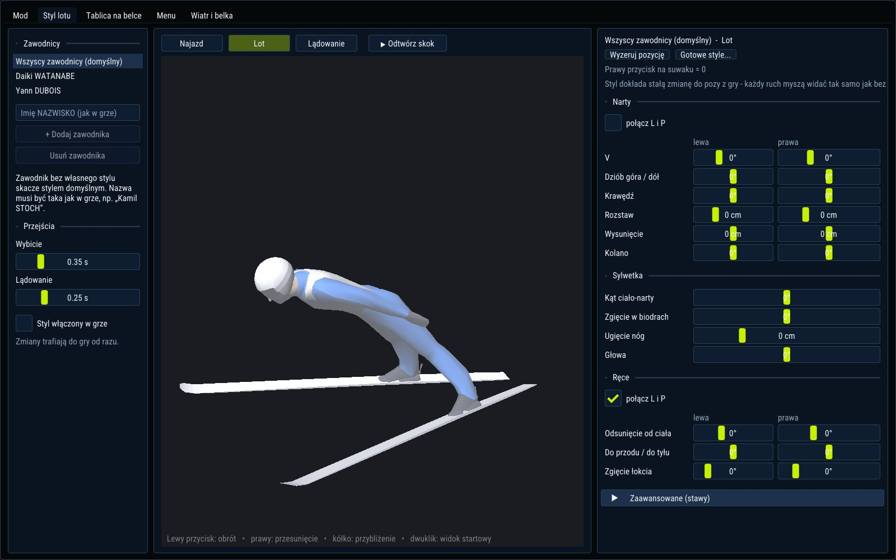

Własna sylwetka skoczków — na najeździe, w locie i przy lądowaniu — z podglądem na prawdziwym modelu skoczka
z gry (model mod wypakowuje przy pierwszym uruchomieniu gry).

- **Zawodnicy** — styl domyślny dla wszystkich i osobne style dla wybranych skoczków, wybieranych z listy skoczków
  gry (także utworzonych w grze); nowy zawodnik zaczyna od stylu domyślnego. Style można kopiować i wklejać,
  duplikować, przywracać do domyślnego i udostępniać w pliku.
- **Pakiety stylów** — cały zestaw stylów zapisany pod nazwą (np. pod puchar) i przełączany jednym kliknięciem;
  pliki w `DSJ4Mod\StylePacks` można wysłać innym graczom.
- **Narty** — V (dziób na zewnątrz), dziób w górę / w dół, krawędź, rozstaw, wysunięcie, kolana; każda narta
  osobno albo obie razem.
- **Sylwetka** — kąt ciało–narty, zgięcie w biodrach, ugięcie nóg, głębokość przysiadu i lądowania (telemark),
  biodra przód / tył, pochylenie tułowia, głowa.
- **Ręce** — odsunięcie od ciała, do przodu / do tyłu, zgięcie łokcia; zaawansowane obroty stawów.
- **Przejścia** — czas przejścia przy wybiciu i lądowaniu; *Odtwórz skok* pokazuje styl na nagranym skoku.

Styl zmienia tylko wygląd skoczka — fizyka lotu i odległość są takie jak w grze. Mimo to, gdy styl zmienia
sylwetkę, gra nie zapisuje rekordów osobistych (patrz [Rekordy](#rekordy-i-następny-zawodnik)).

## Tablica na belce

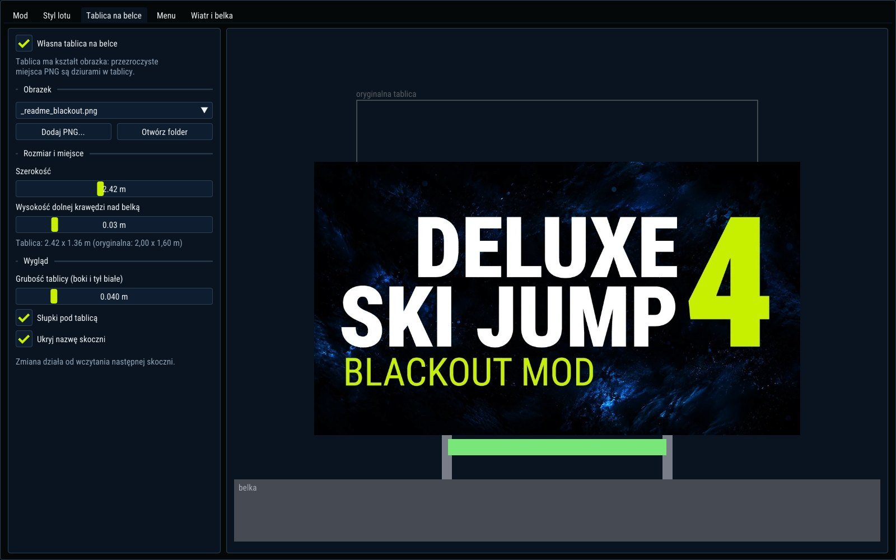

Własna grafika na tablicy przy belce startowej. Tablica ma kształt obrazka PNG (przezroczyste miejsca
są dziurami), ustawiasz jej szerokość, wysokość nad belką, grubość, słupki i ukrycie nazwy skoczni.

## Wiatr i belka

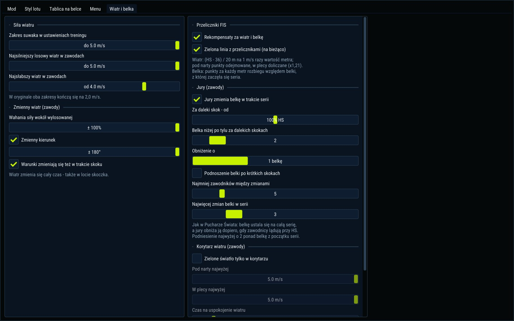

- **Siła wiatru** — zakres suwaka wiatru w ustawieniach treningu oraz najsłabszy i najsilniejszy losowy wiatr
  w zawodach (w oryginale zakresy kończą się na 2,0 m/s).
- **Zmienny wiatr (zawody)** — siła waha się wokół wylosowanej przez grę (np. ±50%), opcjonalnie także
  kierunek (do ±180°). Każdy zawodnik dostaje nowe warunki, które od zielonego światła stoją — albo, z opcją
  *Warunki zmieniają się też w trakcie skoku*, wiatr zmienia się cały czas, także w locie.
- **Przeliczniki FIS** — rekompensaty punktowe za wiatr i belkę liczone jak w Pucharze Świata oraz zielona
  linia „do prowadzenia” z przelicznikami, na bieżąco.
- **Jury** — zmienia belkę w trakcie serii jak w Pucharze Świata: obniża ją dopiero po kilku skokach przy HS.
  Ustawiasz, od ilu % HS skok jest za daleki (domyślnie 100%), po ilu takich skokach belka idzie niżej
  (domyślnie 2) i o ile (1–3), najmniej zawodników między zmianami (5) i najwięcej zmian w serii (3).
  Opcjonalnie podnoszenie belki po serii krótkich skoków (najwyżej 2 ponad belkę z początku serii).
- **Korytarz wiatru** (domyślnie wyłączony) — zielone światło zapala się tylko, gdy wiatr mieści się
  w korytarzu (osobne limity pod narty i w plecy). Przy żółtym wiatr stopniowo słabnie, aż się zmieści.

Gdy działają zmienione zasady wiatru lub przeliczniki, gra nie zapisuje rekordów osobistych
(patrz [Rekordy](#rekordy-i-następny-zawodnik)).

Kierunek wiatru względem skoku mod liczy z ustawienia nart skoczka — zmiana kamery niczego nie zmienia.
Wyłączona karta *Wiatr i belka* = wiatr dokładnie jak w oryginalnej grze. W treningu i online jury i korytarz
są wyłączone.

## Rekordy i następny zawodnik

- **Rekordy życiowe** skoczków (najdłuższy skok i rekord na każdej skoczni) zapisywane w `DSJ4Mod\records.json`
  i dostępne w HUD-zie, z oznaczeniem, gdy skok je pobije. Skoki z gry online się nie zapisują.
- **Następny zawodnik** z listy startowej — także w drugiej i kolejnych seriach.
- **Rekordy osobiste nie zapisują się**, gdy działają zmienione zasady wiatru, przeliczniki albo styl lotu — gra
  wtedy w ogóle nie uznaje skoku za rekord osobisty: nic nie trafia do profilu gracza, nie powstaje powtórka rekordu
  i nie ma czego wysłać na serwer (w `DSJ4Mod\dsj4mod.log` wpis „Rekord osobisty pominiety”). Statystyki i lokalne
  rekordy skoczni zapisują się normalnie, a przy wyłączonych tych funkcjach także rekordy osobiste.

## Gra online

Gdy w modzie działa wiatr z przelicznikami albo własny styl lotu, **gra online jest zablokowana** —
także w standardowym menu gry. Próba wejścia do gry online zamyka grę z komunikatem, że najpierw trzeba
wyłączyć te funkcje w launcherze.

Gdy są wyłączone, w grze online mod i tak sam wyłącza wszystko, co wpływa na skok:

- zasady wiatru i belki, przeliczniki, jury i korytarz,
- styl lotu (skoczkowie mają sylwetkę z gry),
- własne limity wiatru — wracają oryginalne wartości gry.

Działa to niezależnie od ustawień launchera — także gdy ktoś przełączy opcje w trakcie gry online — i także
przy wyłączonym menu moda. Zostaje tylko wygląd: HUD i menu. W `DSJ4Mod\dsj4mod.log` widać początek i koniec
sesji online.

## Licencja

DSJ4 BLACKOUT MOD jest darmowy do użytku prywatnego. Kod źródłowy nie jest publiczny — ze względu na bezpieczeństwo
gry online i rankingów. Mod korzysta z bibliotek zewnętrznych (Dear ImGui, nlohmann/json,
miniz) i czcionki Roboto Condensed na ich własnych licencjach — patrz [THIRD-PARTY-NOTICES.md](THIRD-PARTY-NOTICES.md).

Deluxe Ski Jump 4 jest grą firmy Mediamond. To nieoficjalna modyfikacja, która nie zawiera plików gry.

Błędy i pomysły zgłaszaj w zakładce **[Issues](../../issues)**.
